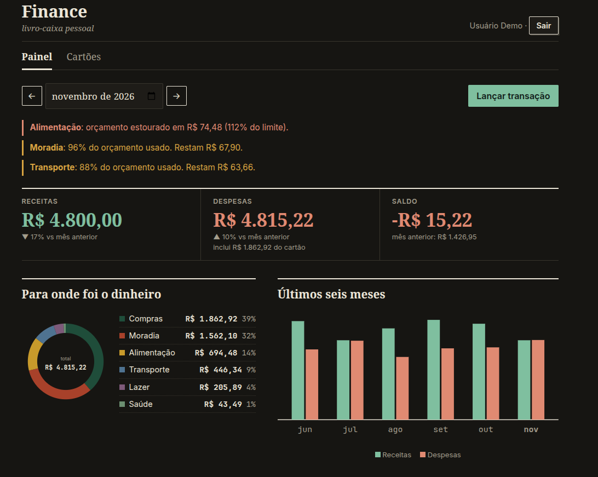
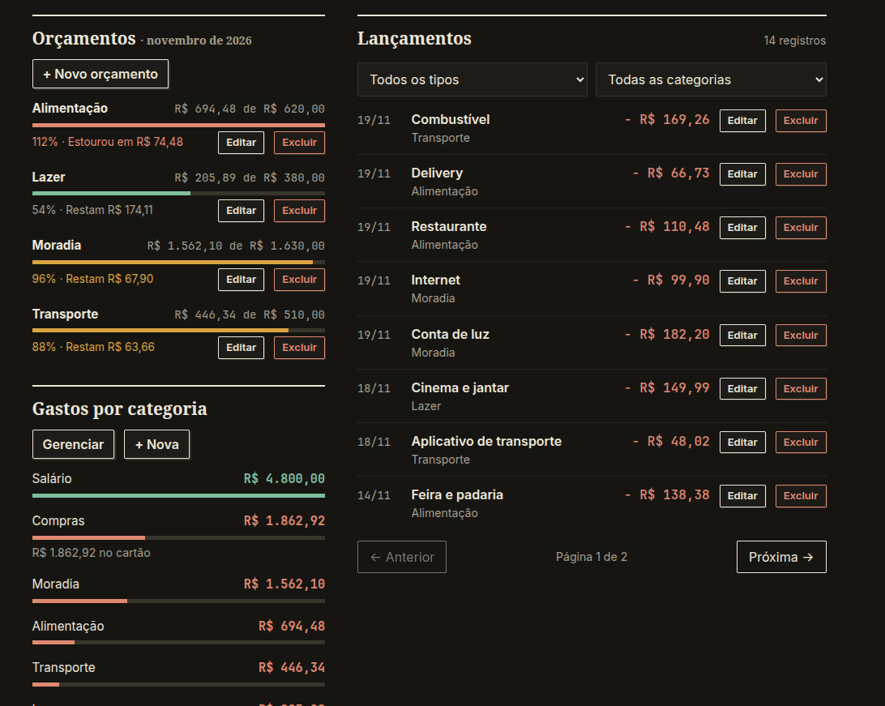
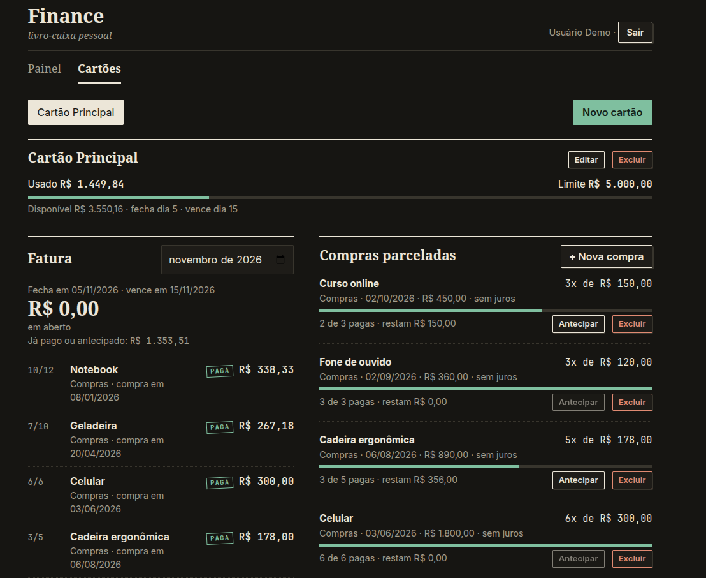

# Finance API

[](https://github.com/Netero-mac/finance-api/actions/workflows/ci.yml)

API REST de controle financeiro pessoal feita com **Laravel**, com uma interface web para usá-la. Cada usuário cadastra categorias e transações, define **orçamentos por categoria com alertas**, controla **cartão de crédito com parcelamento, juros e antecipação de parcelas** e acompanha tudo num painel mensal.

## Demonstração

**https://finance-api-o6mw.onrender.com**

Usuário de teste: `demo@finance.test` · senha: `demo12345`

A demonstração roda no plano gratuito da Render: se ficar um tempo sem acessos, o primeiro carregamento pode levar cerca de 1 minuto. Os dados de exemplo (de janeiro até o mês atual) são recriados a cada reinício do servidor.



*Painel mensal: avisos de orçamento, receitas, despesas e saldo com comparação ao mês anterior, gastos por categoria e evolução dos últimos seis meses.*



*Orçamentos por categoria com barra de progresso e status (dentro do limite, alerta a partir de 80%, estourado), gastos por categoria e lista de lançamentos com filtros, edição e exclusão.*



*Cartão de crédito: limite usado e disponível, fatura do mês, compras parceladas com progresso das parcelas e antecipação de parcelas com desconto.*

## Funcionalidades

**Controle financeiro**
- Cadastro, login e logout com token (Laravel Sanctum)
- CRUD de categorias (receita ou despesa) e de transações, com filtros por período, categoria e tipo, e paginação
- Resumo mensal: receitas, despesas, saldo, total por categoria e comparação com o mês anterior
- Gráficos em SVG: gastos por categoria e últimos seis meses

**Orçamento por categoria**
- Limite mensal por categoria de despesa
- Status automático: dentro do limite, **alerta a partir de 80%** e **estourado** acima de 100%
- Avisos em destaque no painel, com quanto resta ou quanto passou do limite

**Cartão de crédito**
- Cadastro de cartões com limite, dia de fechamento e dia de vencimento
- Compras parceladas **sem juros** (centavos distribuídos sem perda) ou **com juros** (tabela Price)
- Simulação do parcelamento antes de confirmar a compra
- Fatura por mês, com limite usado e disponível
- **Antecipação de parcelas** com desconto proporcional aos juros (valor presente), sem desconto se não houver juros ou se o pagamento for no vencimento ou depois; parcelas pagas liberam o limite
- Os gastos do cartão entram no resumo e nos orçamentos por regime de caixa: a parcela conta no mês do vencimento, ou no mês do pagamento se foi antecipada

**Qualidade**
- Isolamento de dados: cada usuário só acessa os próprios registros (Policies)
- Testes automatizados rodando a cada push (GitHub Actions)
- Deploy com Docker na Render

## Tecnologias

PHP 8.3 · Laravel · Laravel Sanctum · SQLite ou MySQL · PHPUnit · Docker · GitHub Actions · HTML, CSS e JavaScript puro

## Como rodar

Requisitos: PHP 8.3 ou superior, Composer e um banco (SQLite ou MySQL).

```bash
git clone https://github.com/Netero-mac/finance-api.git
cd finance-api

composer install
cp .env.example .env
php artisan key:generate
```

Configure o banco no `.env`. Para SQLite, use `DB_CONNECTION=sqlite`. Para MySQL:

```
DB_CONNECTION=mysql
DB_HOST=127.0.0.1
DB_PORT=3306
DB_DATABASE=finance_api
DB_USERNAME=seu_usuario
DB_PASSWORD=sua_senha
```

Crie as tabelas, os dados de exemplo e suba o servidor:

```bash
php artisan migrate --seed
php artisan serve
```

- Interface web: `http://127.0.0.1:8000`
- API: `http://127.0.0.1:8000/api`
- Usuário de exemplo criado pelo seed: `demo@finance.test` / `demo12345`

> No Windows, evite caminhos com acentos (por exemplo `C:\Users\Usuário`): o `php artisan serve` falha. Use algo como `C:\dev\finance-api`.

## Testes

```bash
php artisan test
```

## Autenticação

Faça login em `/api/login`, copie o `token` da resposta e envie nas rotas protegidas:

```
Authorization: Bearer SEU_TOKEN
Accept: application/json
```

## Endpoints

| Método | Rota | Descrição | Auth |
|---|---|---|---|
| POST | `/api/register` | Cria usuário e devolve o token | Não |
| POST | `/api/login` | Login (limitado a 5 tentativas por minuto) | Não |
| POST | `/api/logout` | Revoga o token atual | Sim |
| GET | `/api/user` | Dados do usuário logado | Sim |
| GET/POST | `/api/categories` | Lista (`?type=income` ou `expense`) e cria categorias | Sim |
| PUT/DELETE | `/api/categories/{id}` | Edita e remove categoria (bloqueado se tiver transações) | Sim |
| GET/POST | `/api/transactions` | Lista com filtros e paginação, e cria transação | Sim |
| PUT/DELETE | `/api/transactions/{id}` | Edita e remove transação | Sim |
| GET/POST | `/api/budgets` | Lista (com gasto, percentual e status) e cria orçamento | Sim |
| PUT/DELETE | `/api/budgets/{id}` | Edita e remove orçamento | Sim |
| GET/POST | `/api/cards` | Lista e cria cartões | Sim |
| PUT/DELETE | `/api/cards/{id}` | Edita e remove cartão | Sim |
| POST | `/api/cards/{id}/simulate` | Simula um parcelamento (com ou sem juros) | Sim |
| GET | `/api/cards/{id}/invoice` | Fatura de um mês (`?month=2026-11`) | Sim |
| GET/POST | `/api/cards/{id}/purchases` | Lista e registra compras parceladas | Sim |
| GET/DELETE | `/api/purchases/{id}` | Mostra e remove uma compra | Sim |
| POST | `/api/purchases/{id}/prepayments/simulate` | Simula a antecipação de parcelas | Sim |
| POST | `/api/purchases/{id}/prepayments` | Antecipa parcelas | Sim |
| GET | `/api/summary` | Resumo mensal (`?month=2026-11`), incluindo cartão | Sim |

### Filtros de transações

| Parâmetro | Exemplo | Descrição |
|---|---|---|
| `from` | `2026-10-01` | Data inicial (AAAA-MM-DD) |
| `to` | `2026-10-31` | Data final |
| `category_id` | `3` | Filtra por categoria |
| `type` | `expense` | `income` ou `expense` |
| `per_page` | `15` | Itens por página (1 a 100) |

## Exemplos

**Login**

```bash
curl -X POST https://finance-api-o6mw.onrender.com/api/login \
  -H "Accept: application/json" -H "Content-Type: application/json" \
  -d '{"email":"demo@finance.test","password":"demo12345"}'
```

**Criar transação**

```bash
curl -X POST http://127.0.0.1:8000/api/transactions \
  -H "Authorization: Bearer SEU_TOKEN" \
  -H "Accept: application/json" -H "Content-Type: application/json" \
  -d '{"category_id":1,"description":"Almoço","amount":25.50,"type":"expense","date":"2026-10-01"}'
```

**Resumo mensal**

```bash
curl "http://127.0.0.1:8000/api/summary?month=2026-10" \
  -H "Authorization: Bearer SEU_TOKEN" -H "Accept: application/json"
```

```json
{
  "month": "2026-10",
  "income": "3000.00",
  "expense": "483.25",
  "balance": "2516.75",
  "by_category": [
    {"category_id": 1, "category": "Salário", "type": "income", "total": "3000.00"},
    {"category_id": 2, "category": "Alimentação", "type": "expense", "total": "483.25"}
  ]
}
```

O resumo também devolve `card_expense` (parte das despesas que veio do cartão) e, por categoria, o valor `card`. Os nomes e formatos exatos dos campos de orçamentos e cartões estão nos testes em `tests/Feature`.

## Códigos de resposta

| Código | Quando acontece |
|---|---|
| 200 / 201 / 204 | Sucesso, criado, removido |
| 401 | Sem token ou credenciais inválidas |
| 403 | Tentativa de acessar dado de outro usuário |
| 409 | Remover categoria que possui transações |
| 422 | Dados inválidos (validação) |

## Decisões técnicas

- **Form Requests** para validação e **API Resources** para padronizar o JSON de resposta.
- **Policies** garantem que um usuário nunca vê nem altera dados de outro.
- Valores monetários usam `decimal(10,2)`, e as somas e divisões são feitas em centavos (inteiros) para evitar erros de arredondamento. No parcelamento sem juros, os centavos que sobram são distribuídos entre as primeiras parcelas.
- Parcelamento com juros usa a **tabela Price** (parcela fixa pela fórmula PMT).
- Antecipação: o valor da parcela é trazido a valor presente, `parcela / (1 + i)^(dias/30)`. Sem juros, ou pagando no vencimento ou depois, não há desconto.
- Orçamentos e resumo consideram o cartão por **regime de caixa**, em um serviço dedicado (`CardSpending`) usado pelos dois, para os números nunca divergirem.
- Datas são comparadas com `whereDate`, para não perder registros do último dia do mês no SQLite.
- `user_id` nunca vem da requisição: sempre do usuário autenticado.
- A interface é um único HTML servido pelo próprio Laravel, no mesmo endereço da API, o que dispensa CORS.
- O token fica no `localStorage`, suficiente para este projeto. Em produção, o ideal seria um cookie `HttpOnly`.

## Estrutura

```
app/
├── Enums/
├── Http/
│   ├── Controllers/Api/   Auth, Category, Transaction, Budget, CreditCard,
│   │                      CardPurchase, CardInvoice, CardPrepayment, Summary
│   ├── Requests/          validação de entrada
│   └── Resources/         formato das respostas
├── Models/                User, Category, Transaction, Budget,
│                          CreditCard, CardPurchase, CardInstallment
├── Policies/              regras de acesso
└── Services/              CardPurchasePlanner, EarlyPaymentCalculator, CardSpending
database/seeders/          dados de demonstração (janeiro até o mês atual)
docs/                      capturas de tela
public/app.html            interface web
tests/Feature/             Auth, Category, Transaction, Summary, Budget,
                           CreditCard, CardPurchase, Prepayment, CardIntegration
Dockerfile                 imagem usada no deploy
```

## Autor

Feito por [Netero-mac](https://github.com/Netero-mac), estudante de Sistemas de Informação.

## Licença

Distribuído sob a licença MIT. Veja [LICENSE](LICENSE).
