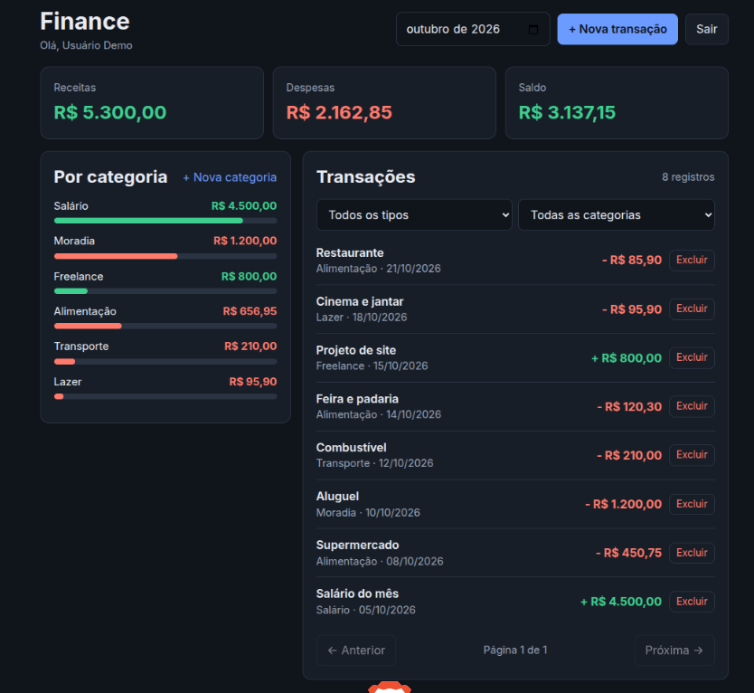

# Finance API

[](https://github.com/Netero-mac/finance-api/actions/workflows/ci.yml)

API REST de controle financeiro pessoal feita com **Laravel**, com uma interface web simples para usá-la. Cada usuário cadastra suas categorias e transações (receitas e despesas), filtra por período e consulta um resumo mensal com saldo.

## Demonstração

**https://finance-api-o6mw.onrender.com**

Usuário de teste: `demo@finance.test` · senha: `demo12345`

A demonstração roda no plano gratuito da Render: se ficar um tempo sem acessos, o primeiro carregamento pode levar cerca de 1 minuto. Os dados de exemplo são recriados a cada reinício do servidor.



## Funcionalidades

- Cadastro, login e logout com token (Laravel Sanctum)
- CRUD de categorias (receita ou despesa)
- CRUD de transações com filtros por período, categoria e tipo, e paginação
- Resumo mensal: total de receitas, despesas, saldo e total por categoria
- Isolamento de dados: cada usuário só acessa os próprios registros (Policies)
- Interface web em um único arquivo HTML (`public/app.html`), sem dependências externas
- Testes automatizados rodando a cada push (GitHub Actions)
- Deploy com Docker na Render

## Tecnologias

PHP 8.3 · Laravel · Laravel Sanctum · SQLite ou MySQL · PHPUnit · Docker · GitHub Actions · HTML, CSS e JavaScript puro

## Como rodar

Requisitos: PHP 8.3 ou superior, Composer e um banco (SQLite ou MySQL).

```bash
git clone https://github.com/Netero-mac/finance-api.git
cd finance-api

composer install
cp .env.example .env
php artisan key:generate
```

Configure o banco no `.env`. Para SQLite, use `DB_CONNECTION=sqlite`. Para MySQL:

```
DB_CONNECTION=mysql
DB_HOST=127.0.0.1
DB_PORT=3306
DB_DATABASE=finance_api
DB_USERNAME=seu_usuario
DB_PASSWORD=sua_senha
```

Crie as tabelas, os dados de exemplo e suba o servidor:

```bash
php artisan migrate --seed
php artisan serve
```

- Interface web: `http://127.0.0.1:8000`
- API: `http://127.0.0.1:8000/api`
- Usuário de exemplo criado pelo seed: `demo@finance.test` / `demo12345`

## Testes

```bash
php artisan test
```

## Autenticação

Faça login em `/api/login`, copie o `token` da resposta e envie nas rotas protegidas:

```
Authorization: Bearer SEU_TOKEN
Accept: application/json
```

## Endpoints

| Método | Rota | Descrição | Auth |
|---|---|---|---|
| POST | `/api/register` | Cria usuário e devolve o token | Não |
| POST | `/api/login` | Login (limitado a 5 tentativas por minuto) | Não |
| POST | `/api/logout` | Revoga o token atual | Sim |
| GET | `/api/user` | Dados do usuário logado | Sim |
| GET | `/api/categories` | Lista categorias (`?type=income` ou `expense`) | Sim |
| POST | `/api/categories` | Cria categoria | Sim |
| GET | `/api/categories/{id}` | Mostra categoria | Sim |
| PUT | `/api/categories/{id}` | Edita categoria | Sim |
| DELETE | `/api/categories/{id}` | Remove categoria (bloqueado se tiver transações) | Sim |
| GET | `/api/transactions` | Lista transações com filtros e paginação | Sim |
| POST | `/api/transactions` | Cria transação | Sim |
| GET | `/api/transactions/{id}` | Mostra transação | Sim |
| PUT | `/api/transactions/{id}` | Edita transação | Sim |
| DELETE | `/api/transactions/{id}` | Remove transação | Sim |
| GET | `/api/summary` | Resumo mensal (`?month=2026-10`) | Sim |

### Filtros de transações

| Parâmetro | Exemplo | Descrição |
|---|---|---|
| `from` | `2026-10-01` | Data inicial (AAAA-MM-DD) |
| `to` | `2026-10-31` | Data final |
| `category_id` | `3` | Filtra por categoria |
| `type` | `expense` | `income` ou `expense` |
| `per_page` | `15` | Itens por página (1 a 100) |

## Exemplos

**Login**

```bash
curl -X POST https://finance-api-o6mw.onrender.com/api/login \
  -H "Accept: application/json" -H "Content-Type: application/json" \
  -d '{"email":"demo@finance.test","password":"demo12345"}'
```

**Criar categoria**

```bash
curl -X POST http://127.0.0.1:8000/api/categories \
  -H "Authorization: Bearer SEU_TOKEN" \
  -H "Accept: application/json" -H "Content-Type: application/json" \
  -d '{"name":"Alimentação","type":"expense"}'
```

```json
{
  "data": {
    "id": 1,
    "name": "Alimentação",
    "type": "expense",
    "created_at": "2026-10-15T19:00:00.000000Z"
  }
}
```

**Criar transação**

```bash
curl -X POST http://127.0.0.1:8000/api/transactions \
  -H "Authorization: Bearer SEU_TOKEN" \
  -H "Accept: application/json" -H "Content-Type: application/json" \
  -d '{"category_id":1,"description":"Almoço","amount":25.50,"type":"expense","date":"2026-10-01"}'
```

**Listar com filtros**

```bash
curl "http://127.0.0.1:8000/api/transactions?from=2026-10-01&to=2026-10-31&type=expense" \
  -H "Authorization: Bearer SEU_TOKEN" -H "Accept: application/json"
```

**Resumo mensal**

```bash
curl "http://127.0.0.1:8000/api/summary?month=2026-10" \
  -H "Authorization: Bearer SEU_TOKEN" -H "Accept: application/json"
```

```json
{
  "month": "2026-10",
  "income": "3000.00",
  "expense": "483.25",
  "balance": "2516.75",
  "by_category": [
    {"category_id": 1, "category": "Salário", "type": "income", "total": "3000.00"},
    {"category_id": 2, "category": "Alimentação", "type": "expense", "total": "483.25"}
  ]
}
```

## Códigos de resposta

| Código | Quando acontece |
|---|---|
| 200 / 201 / 204 | Sucesso, criado, removido |
| 401 | Sem token ou credenciais inválidas |
| 403 | Tentativa de acessar dado de outro usuário |
| 409 | Remover categoria que possui transações |
| 422 | Dados inválidos (validação) |

## Decisões técnicas

- **Form Requests** para validação e **API Resources** para padronizar o JSON de resposta.
- **Policies** garantem que um usuário nunca vê nem altera dados de outro.
- A categoria de uma transação precisa ser do próprio usuário, e o tipo da transação precisa ser igual ao da categoria.
- Valores monetários usam `decimal(10,2)`, e o resumo soma em centavos (inteiros) para evitar erros de arredondamento.
- `user_id` não é preenchido pela requisição: sempre vem do usuário autenticado.
- O resumo usa consultas agregadas (`SUM` com `GROUP BY`) em vez de somar em PHP.
- A interface é um único HTML servido pelo próprio Laravel, no mesmo endereço da API, o que dispensa configuração de CORS.
- O token fica no `localStorage` do navegador, o que é suficiente para este projeto. Em produção, o ideal seria um cookie `HttpOnly`.

## Estrutura

```
app/
├── Enums/TransactionType.php
├── Http/
│   ├── Controllers/Api/   Auth, Category, Transaction, Summary
│   ├── Requests/          validação de entrada
│   └── Resources/         formato das respostas
├── Models/                User, Category, Transaction
└── Policies/              regras de acesso
database/seeders/          dados de demonstração
public/app.html            interface web
tests/Feature/             Auth, Category, Transaction, Summary
Dockerfile                 imagem usada no deploy
```

## Autor

Feito por [Netero-mac](https://github.com/Netero-mac), estudante de Sistemas de Informação.
